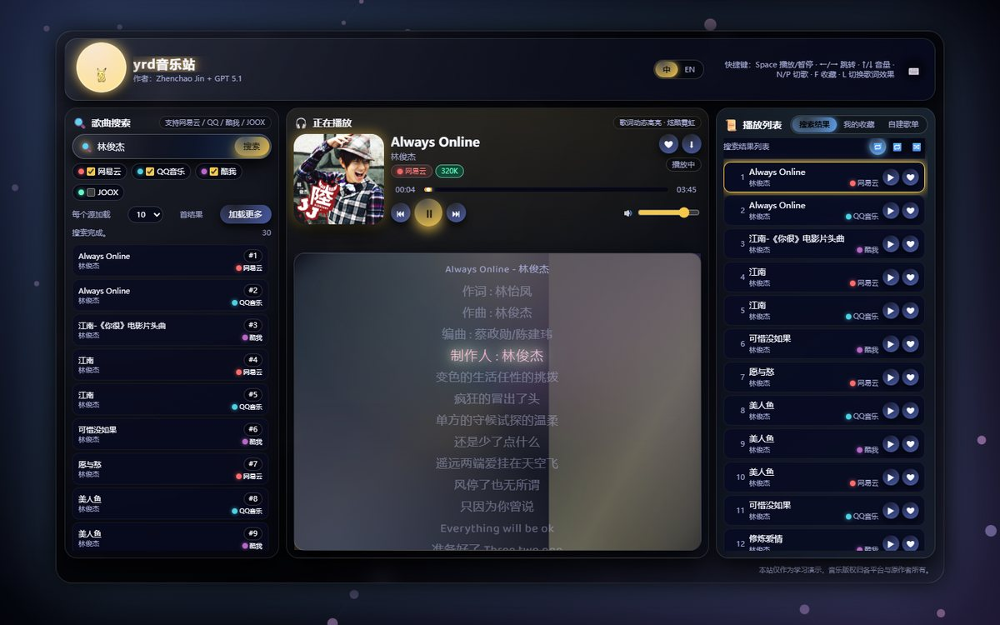
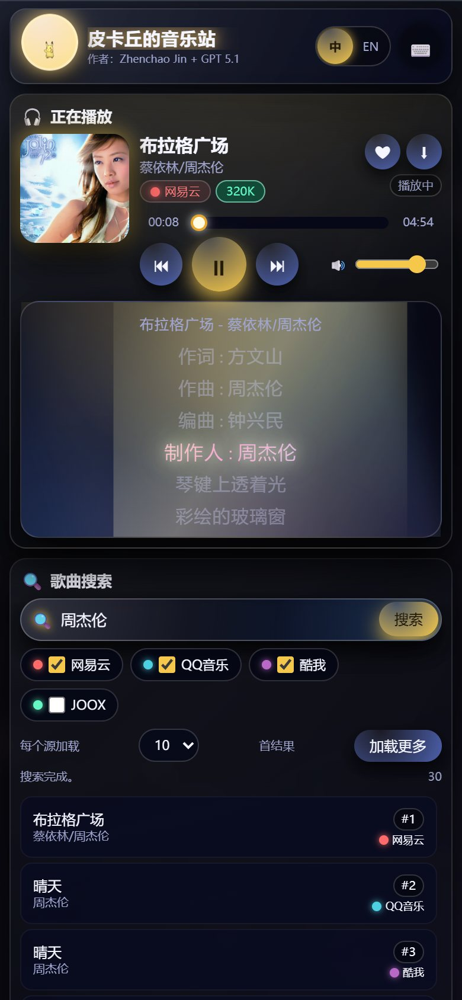
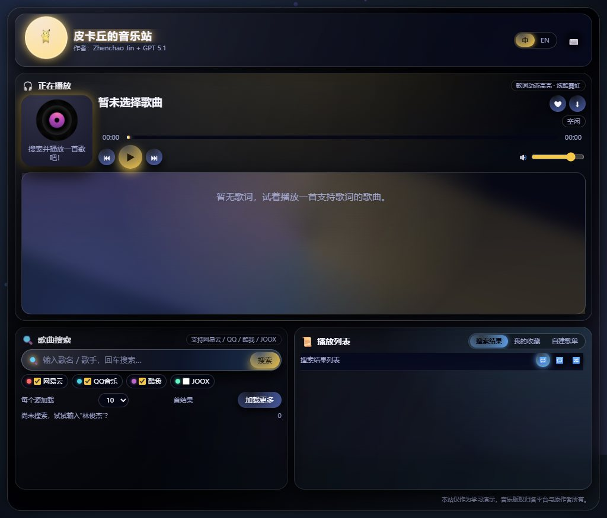

# 皮卡丘的音乐站 · Pikachu Music

基于 [CharlesPikachu/musicsquare](https://github.com/CharlesPikachu/musicsquare) 重构的版本：保留原站的全部功能与第三方音频接口，重新组织为 `HTML + CSS + 原生 JS` 的静态站点，并针对手机、平板和横屏做了完整的响应式适配。既可本地运行，也已部署到 GitHub Pages。

- **在线访问：<https://dejavudejavu.github.io/yrd-music/>**
- **仓库地址：<https://github.com/dejavudejavu/yrd-music>**
- 零构建、零依赖：克隆后直接启动即可
- 桌面 / 平板 / 手机自适应，触屏操作可用
- 四个音乐源：网易云、QQ 音乐、酷我、JOOX
- 播放器、动态歌词、收藏、自建歌单、导入导出、中英切换、快捷键等完整保留
- 字体已本地化（Baloo 2 / Nunito），不依赖 Google Fonts，离线也能快速打开







---

## 快速开始

环境要求：**Node.js 18+**（仅用于本地静态服务器，无任何 npm 依赖）。

```bash
# 方式一：npm
npm start

# 方式二：直接运行
node server.js

# 方式三：Windows 双击
start.bat
```

打开终端提示的地址，默认是：

```
http://127.0.0.1:5173/
```

### 自定义端口

```bash
node server.js --port 8080
# 或
set PORT=8080 && npm start        # Windows PowerShell: $env:PORT=8080; npm start
```

端口被占用时会自动尝试下一个端口。

### 手机 / 局域网调试

```bash
npm run start:lan
# 等价于 node server.js --host 0.0.0.0
```

启动后终端会打印局域网地址（例如 `http://192.168.1.23:5173/`），手机与电脑连接同一 Wi-Fi 后直接访问即可。

> 手机访问需要第三方音乐接口可从手机网络访问；部分平台接口对网络环境较敏感。

---

## 功能清单

| 模块 | 功能 |
| --- | --- |
| 搜索 | 网易云 / QQ / 酷我 / JOOX 多源聚合搜索，结果按来源交错排列 |
| 搜索控制 | 勾选音乐源、每个源 5/10/20/30 首、加载更多、列表滚动自动加载 |
| 播放器 | 封面、标题、歌手、来源、音质标签、播放/暂停、上一首/下一首 |
| 进度与音量 | 进度条点击/拖动跳转、时间显示、音量滑杆、键盘调节 |
| 歌词 | LRC 解析、逐行动态高亮、自动滚动、`L` 键切换霓虹特效 |
| 收藏 | 单曲收藏/取消，`localStorage` 持久化 |
| 自建歌单 | 新建、删除、加入当前歌曲、移除歌曲、切换歌单 |
| 导入 / 导出 | 导出全部收藏与歌单为 JSON；导入本站导出的 JSON（去重合并） |
| 播放模式 | 列表循环、单曲循环、随机播放 |
| 国际化 | 中文 / English 全量切换，语言偏好持久化 |
| 交互 | Toast 提示、水波纹反馈、背景粒子（随音量脉冲）、弹窗 |
| 快捷键 | `Space` 播放/暂停、`←/→` 快退/快进 5 秒、`↑/↓` 音量、`N/P` 切歌、`F` 收藏、`L` 歌词特效、`M` 静音、`/` 聚焦搜索、`Esc` 关闭弹窗 |
| 移动端增强 | 触屏拖拽进度、Media Session 锁屏控制、安全区适配、触摸目标放大 |
| 无障碍 | 语义化按钮、`aria-label`、`role="slider"` 进度条、键盘可操作搜索结果 |

---

## 接口说明（与原站一致）

所有请求都由浏览器直接发起，地址、参数、字段解析与原站保持一致，可在 [`assets/js/api.js`](assets/js/api.js) 中统一查看或替换。本站没有额外的后端代理。

| 平台 | 用途 | 接口 |
| --- | --- | --- |
| 网易云 | 搜索 | `https://api.qijieya.cn/meting/?type=search&id={关键词}&limit={数量}&server=netease` |
| 网易云 | 播放地址 | `https://api.qijieya.cn/meting/?server=netease&type=url&id={songid}` |
| 网易云 | 封面 | `https://api.qijieya.cn/meting/?server=netease&type=pic&id={picid}` |
| 网易云 | 歌词 | `https://api.qijieya.cn/meting/?server=netease&type=lrc&id={songid}` |
| QQ 音乐 | 搜索 | `https://tang.api.s01s.cn/music_open_api.php?msg={关键词}&type=json` |
| QQ 音乐 | 详情（播放地址 / 歌词） | `https://tang.api.s01s.cn/music_open_api.php?msg={关键词}&type=json&mid={song_mid}` |
| 酷我 | 搜索 | `https://oiapi.net/api/Kuwo?msg={关键词}&page=1&limit={数量}` |
| 酷我 | 详情（播放地址 / 歌词） | `https://oiapi.net/api/Kuwo?msg={关键词}&n={序号}&br=1` |
| JOOX | 搜索 | `https://apicx.asia/api/joox_music?msg={关键词}&token={TOKEN}&br=4` |
| JOOX | 详情（播放地址 / 歌词） | `https://apicx.asia/api/joox_music?msg={关键词}&n={序号}&token={TOKEN}&br=4` |

说明：

- 这些是第三方公开接口，可用性、音质、版权与地域限制由平台决定，可能随时变化。
- QQ 音乐中标记为“付费”的歌曲通常不会返回播放地址；免费歌曲可以正常播放。
- 酷我接口返回的是带时效签名的直链，偶发 `410 Gone` 属于接口侧限制，可切换其他音源或稍后重试。
- JOOX 详情会优先探测可用的最高音质链接；探测失败时会回退到接口返回的首选链接，交由播放器实际判断。

---

## 项目结构

```
musicweb/
├── index.html                # 页面结构
├── assets/
│   ├── css/style.css         # 全部样式（含桌面/平板/手机断点）
│   ├── js/
│   │   ├── i18n.js           # 中英文文案
│   │   ├── api.js            # 四个平台的搜索 / 详情 / 歌词解析
│   │   └── app.js            # 状态、播放器、歌词、收藏、歌单、快捷键、粒子
│   ├── img/pikachu.gif       # 皮卡丘动图
│   └── fonts/                # 本地字体 Baloo 2 / Nunito 与 OFL 许可证
├── docs/                     # README 预览图
├── server.js                 # 零依赖静态服务器（端口 / 局域网）
├── start.bat                 # Windows 一键启动
├── package.json
├── LICENSE                   # Apache-2.0（沿用原项目）
└── README.md
```

---

## 移动端适配

- **≥1081px**：原站三栏布局（搜索 / 播放器 / 播放列表），页面不滚动，面板内部滚动。
- **861–1080px**：播放器独占一行，搜索与播放列表并排；页面自然滚动，歌词保持 240px 高度，避免被压扁。
- **≤860px**：单栏堆叠为「播放器 → 搜索 → 播放列表」，整页纵向滚动；搜索列表与播放列表各自限制最大高度并独立滚动。
- **≤560px**：边到边全宽布局、更紧凑的头部与播放器、隐藏非关键副标题与封面提示。
- **≤380px**：进一步压缩封面、按钮与字号，隐藏作者行。
- **横屏手机**：压缩封面与歌词高度，内容可滚动。
- 触屏：进度条支持指针拖动、按钮与列表触摸目标放大、`hover` 效果仅在鼠标设备启用。
- 使用 `100dvh`、`env(safe-area-inset-*)` 处理移动浏览器地址栏与刘海安全区。

---

## 数据存储

数据仅保存在浏览器本地：

| 键 | 内容 |
| --- | --- |
| `pikachu-music-lang` | 语言偏好（`zh` / `en`） |
| `pikachu-music-library-v1` | 收藏与自建歌单（版本化 JSON） |

键名与原站一致。注意浏览器是按「协议 + 域名 + 端口」隔离 `localStorage` 的，从原站（`charlespikachu.github.io`）换到本地（`127.0.0.1:5173`）不会自动共享数据；请用「导出歌单」下载 JSON，再在本地「导入歌单」完成迁移。清除浏览器站点数据会同时清空这些内容。

**手机端可以正常保存**，机制与桌面完全相同；数据属于手机浏览器，不会回传电脑，也不会在手机与电脑之间自动同步。需要注意：

- 手机访问的地址就是数据所属的 origin。用 `http://192.168.1.23:5173` 保存的数据，在 `http://127.0.0.1:5173` 或路由器重新分配 IP 后都看不到；建议给电脑设置固定局域网 IP，或直接使用固定的 Pages 地址 `https://dejavudejavu.github.io/yrd-music/`。
- 无痕/隐私模式关闭窗口后清空；手动清除网站数据、系统清理存储也会丢失。
- iOS Safari 对长期未访问站点的脚本存储可能执行回收（版本策略不同），重要歌单建议定期「导出歌单」备份到「文件」或网盘。
- 换手机、换浏览器或换端口后，用「导出 / 导入」迁移；同时开多个标签页修改时以最后一次写入为准。

---

## 自定义

- **主题色**：修改 [`assets/css/style.css`](assets/css/style.css) 顶部的 `:root` 变量（`--accent`、`--accent-pink` 等）。
- **接口 / Token**：修改 [`assets/js/api.js`](assets/js/api.js) 中的 URL 构造函数与 `JOOX_TOKEN`。
- **默认音乐源与数量**：修改 [`assets/js/app.js`](assets/js/app.js) 中 `state.enabledSources` / `state.perSourceLimit`。
- **端口与监听地址**：`node server.js --port 8080 --host 0.0.0.0`。

---

## 部署到 GitHub Pages

当前仓库已经按以下方式部署：

- 仓库：`dejavudejavu/yrd-music`，分支 `main`
- Pages 来源：`main` 分支根目录（`/`）
- 根目录的 `.nojekyll` 让 GitHub Pages 直接按静态文件发布，不经过 Jekyll
- 站点为纯静态资源，所有路径均为相对路径，因此可以运行在 `/yrd-music/` 子路径下
- 页面通过 HTTPS 访问，`assets/js/api.js` 中的 `toHttps()` 会把平台返回的音频/封面地址升级为 HTTPS，避免混合内容被浏览器拦截

如果要部署到你自己的仓库：

1. 新建一个公开仓库，把本项目推送到 `main`
2. 仓库 **Settings → Pages → Build and deployment**
3. Source 选择 **Deploy from a branch**，Branch 选择 `main`，目录选择 `/ (root)`
4. 等待 1–2 分钟，访问 `https://<用户名>.github.io/<仓库名>/`

不需要 GitHub Actions，也不需要执行构建命令。

---

## 已知限制

- 第三方接口依赖公网，网络受限、接口限流或平台策略变化时可能出现搜索为空、音源 410/403 等情况。
- 酷我接口返回的直链目前可能失效（HTTP/HTTPS 均为 410），搜索仍可用，但播放可能失败；可切换网易云 / QQ / JOOX。
- QQ 音乐中标记为“付费”的歌曲通常不会返回播放地址；免费歌曲可以正常播放。
- 浏览器自动播放策略可能阻止切歌后的自动播放：此时播放器会停在“已暂停”，点一下播放即可（移动端常见）。
- 音频版权归各平台与原作者所有，本项目仅用于学习与前端演示。

---

## 致谢与许可

- 原项目：[CharlesPikachu/musicsquare](https://github.com/CharlesPikachu/musicsquare)（Apache-2.0），界面与交互设计归原作者所有。
- 字体：[Baloo 2](https://fonts.google.com/specimen/Baloo+2)、[Nunito](https://fonts.google.com/specimen/Nunito)，SIL Open Font License 1.1，许可证文本见 `assets/fonts/`。
- 音乐数据与版权归网易云音乐、QQ 音乐、酷我音乐、JOOX 及各版权方所有；本站不存储任何音频文件。

本项目沿用原项目的 **Apache License 2.0**，详见 [LICENSE](LICENSE)。
